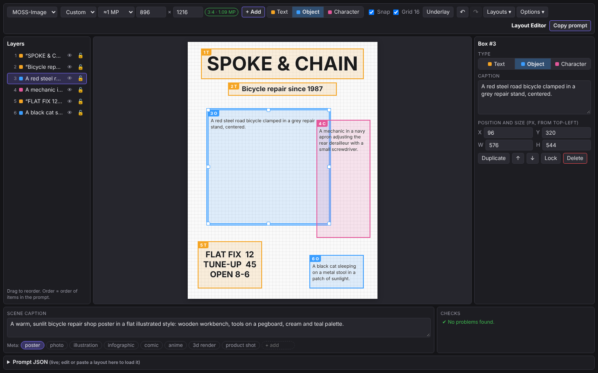
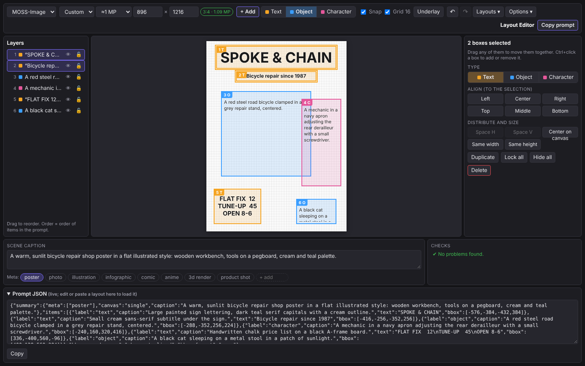

# Layout Editor for SwarmUI

A visual editor for **layout prompts**: draw boxes on a canvas, caption each one, and get the JSON prompt that layout-aware image models read. The first supported format is **[MOSS-Image](https://github.com/OpenMOSS/MOSS-Image)** (OpenMOSS).



It runs two ways from the same code:

- **In SwarmUI**: choose **Layout Editor (boxes)** in the **+** menu beside the prompt. The editor opens in a modal. **Apply** writes the layout into the prompt; **Generate** runs Swarm's normal generation and shows the results in the editor.
- **Standalone**: `standalone/index.html` works in any browser, even from a local file. Copy the prompt and paste it into SwarmUI, ComfyUI or Forge Neo.

## Install

**From SwarmUI** (once the extension is in Swarm's extension list): Server → Extensions → install **LayoutEditor**, then restart when Swarm asks.

**Manually**:

1. Clone this repo into `SwarmUI/src/Extensions/`:
   `cd SwarmUI/src/Extensions && git clone https://github.com/ALT_ACCOUNT/SwarmUI-LayoutEditor`
2. Rebuild Swarm, since extensions are compiled: create an empty file `SwarmUI/src/bin/must_rebuild`, then start Swarm with `launch-windows.bat`, `launch-linux.sh` or `launch-macos.sh`.
3. The console prints `Layout Editor extension loaded.`

To update: `git pull` in the extension folder and restart Swarm. JS/CSS-only changes need no rebuild, but Swarm caches extension files in memory, so it must restart.

## Using it

1. Select a MOSS-Image model.
2. Click **+** beside the prompt → **Layout Editor (boxes)**. The canvas starts at Swarm's current resolution.
3. Write the **scene caption** (the whole image) at the bottom.
4. Press **T** (text) or **O** (object) and drag on the canvas, or click **+ Add** (key **N**). The cursor jumps into the new box:
   - Text box: type the exact words, **Tab**, then describe how they look.
   - Object box: describe it, then **Enter**.
5. **Ctrl+Enter** or **Generate**: results appear under the canvas, and the newest one is shown under the boxes so you can compare.
6. **Apply**: writes the JSON into the prompt (replacing it), sets Swarm's resolution to the canvas size, and closes the editor.

Opening the editor when the prompt already holds a MOSS layout (from an LLM, ComfyUI, or an earlier Apply) loads that layout.



### Shortcuts

| Key | Action |
| --- | --- |
| T / O / C | Type for new boxes (C needs Options → Character type) |
| N or **+ Add** | Add a box of the selected type in a free spot |
| Drag | Draw a box; drag a box to move it, its handles to resize |
| Shift-drag | Draw over existing boxes (or lock the box below) |
| Alt-drag | Duplicate; Alt while dragging turns snapping off |
| Ctrl+click | Add or remove a box from the selection (Layers list: Shift+click selects a range) |
| Ctrl-drag on empty canvas | Select the boxes inside a rectangle |
| Ctrl+A | Select all |
| Shift+T / O / C | Change the selected boxes' type |
| Double-click | Edit a box on the canvas |
| Enter | Edit the selected box in the inspector |
| Arrows / Shift+arrows | Nudge 1 px / 16 px |
| Ctrl+D | Duplicate |
| Delete | Delete the selected boxes |
| Ctrl+Z / Ctrl+Shift+Z | Undo / redo |
| Ctrl+Enter | Generate (Swarm) or copy the prompt (standalone) |
| Esc | Deselect, leave a field, then close the editor |

### Features

- Snapping to canvas edges and center, other boxes' edges and centers, and a 16 px grid.
- Multi-selection: move together, change type, align, space evenly, center on canvas, match width/height, lock, hide, delete.
- Layers panel: drag to reorder (order = order of `items` in the prompt), hide (not exported), lock.
- Live checks:
  - boxes outside the canvas, empty captions, text boxes with no text
  - text likely too small to render legibly, more than about 12 boxes
  - resolution not a multiple of 16, or outside 0.25–4 MP
  - `<` `>` characters, which Swarm reads as prompt tags
- Prompt JSON panel: always shows the exact prompt; edit or paste JSON there to load it.
- Underlay: put a reference image or a result under the boxes, with adjustable opacity.
- Keep seed: reuse the last result's seed to compare layout changes fairly.
- Autosave, named layouts, and export/import as `.json` files.

## MOSS-Image format

Per the [MOSS-Image user guide](https://github.com/OpenMOSS/MOSS-Image/blob/main/USERGUIDE.md):

```json
{"summary":{"meta":["poster"],"canvas":"single","caption":"..."},
 "items":[{"label":"text","caption":"...","text":"EXPLORE","bbox":[-416,-384,-288,384]},
          {"label":"object","caption":"...","bbox":[-192,-288,384,288]}],
 "bbox_coord_space":"abs_centralized","bbox_format":"yxyx"}
```

`bbox` is `[y_min, x_min, y_max, x_max]` in pixels, with the origin at the canvas center. The generation width and height must match the canvas size, which Apply and Generate handle in Swarm.

The optional **Character** type writes `"label":"character"`. That label comes from ComfyUI's MOSS-Image Layout Prompt node, not the official spec, so it is off by default.

## How it integrates with SwarmUI

In short: the C# side only registers web files; everything runs in the browser, using Swarm's own generation path. There are no new parameters, API routes, ComfyUI nodes or settings. See **[docs/INTEGRATION.md](docs/INTEGRATION.md)** for every touch point with Swarm.

## Privacy and connections

The extension makes no network connections of its own. All scripts and styles are local files. Layouts are kept in your browser's local storage.

## Development

This extension was developed with substantial help from an AI coding assistant (Claude). Please report anything that misbehaves in the issues.

Project layout:

```
LayoutEditorExtension.cs / .csproj   Swarm extension: registers the web files
Assets/core/                         host-independent editor (plain scripts, no build step)
    le-model.js     canonical model (normalized boxes, any format)
    le-formats.js   format profiles; MOSS-Image import/export
    le-validate.js  checks
    le-editor.js    the editor UI
    le-editor.css   styles (uses Swarm theme variables)
Assets/swarm-layout-editor.js/.css   Swarm host: + menu entry, modal, Apply, generation
standalone/index.html                standalone host
docs/                                integration notes and screenshots
```

New formats (Ideogram 4 is next) are added as profiles in `le-formats.js`.

## License

MIT. See [LICENSE](LICENSE).
